<div align="center">



# Cho — CTF Workspace

**An open-source, AI-assisted terminal workspace for Capture-the-Flag competitions and isolated practice labs.**
*One shell · a local AI teammate · 100+ tools · controlled execution.*

[](https://github.com/kevinmathew47/Cho/actions/workflows/ci.yml)
[](https://kevinmathew47.github.io/Cho/)
[](LICENSE)


[**Website**](https://kevinmathew47.github.io/Cho/) · [**About**](https://kevinmathew47.github.io/Cho/about.html) · [Features](#-features) · [Install](#-install) · [Safety](#-safety--scope)

</div>

> [!WARNING]
> **Authorised use only.** Use Cho for CTFs you are entered in and practice environments you are allowed to use. It is an **assistant, not an autopilot** — it does not guarantee a solve and will not exploit a real target on its own. Follow each competition's rules on AI and automation.

<div align="center">


</div>

---

## ✦ Features

| | |
|---|---|
| 🖥️ **One terminal** | A real Kali/WSL, container, or PowerShell shell in the challenge folder. Run commands, or type `? your question` to ask the AI — same prompt. |
| 🤖 **Local AI teammate** | Cho runs on [Ollama](https://ollama.com) on your own hardware. It suggests the next step and the command; you approve each one. Nothing leaves your machine. |
| ✓ **Verified vs assumed** | Cho labels what it can prove from real output (`VERIFIED:`) separately from what it guesses (`ASSUMPTION:`). |
| 🔍 **Built-in analysis** | File-type & metadata inspection, hidden-data detection, entropy, flag scanning, and chained auto-decoding — before you install a single tool. |
| 🧰 **100+ tools** | A catalogue across all six CTF categories, each with an example command and a one-line install. Mirrors the [awesome-ctf](https://github.com/apsdehal/awesome-ctf) stack. |
| 🎯 **Remote targets, safely** | Authorise a Hack The Box IP or challenge URL per challenge; `fetch <url>` pulls an authorised page in and scans it. Any other host is refused. |
| 🛡️ **Controlled execution** | Destructive commands blocked, network commands held for your approval, and an optional no-network container sandbox. |
| 📁 **Projects** | Each challenge is a plain folder with its files, notes, candidate flags and command history. |

## ✦ Six categories, one workspace

| Category | What's inside |
|---|---|
| **Cryptography** | RSA attacks, XOR tools, hash ID, classical ciphers, a built-in decoder |
| **Forensics** | Sleuth Kit, Volatility, ExifTool, binwalk, foremost, tshark, pcap carving |
| **Steganography** | zsteg, steghide/stegseek, outguess, spectrograms, bit-plane tools |
| **Reversing** | Ghidra, radare2, GDB, objdump, apktool/jadx, angr, Frida |
| **Exploitation / pwn** | pwntools, checksec, ROPgadget, ropper, one_gadget, Metasploit |
| **Web** | curl, gobuster, ffuf, sqlmap, nikto, Burp, ZAP + remote-target fetching |

## ✦ Install

```bash
git clone https://github.com/kevinmathew47/Cho.git
cd Cho
npm install
npm start
```

Then, from the app's **Settings** (gear, top-right):

1. **Kali (WSL)** — one-click `wsl --install -d kali-linux`, then run the bundled `scripts/setup-wsl.sh` to install the tool stack.
2. **Ollama** — one-click install, then download a model such as `qwen2.5:7b`.
3. **Container mode** *(optional)* — `docker build -t cho-ctf-tools:latest docker/`.

None of these are required to try it: open the app, drop in a challenge file, and the built-in analysis and terminal work immediately.

> **Try it now** — drop [`samples/practice-evidence.zip`](samples/practice-evidence.zip) onto the window, set the flag format to `flag{...}`, and ask Cho to solve it.

## ✦ How it works

Electron shell · sandboxed renderer · a Node main process that runs the analysis, classifies every command (allow / approve / block), enforces the authorised-target scope, and relays to the local model. Full write-up in [docs/ARCHITECTURE.md](docs/ARCHITECTURE.md).

## ✦ Safety & scope

- Work stays inside the challenge folder and the hosts you authorise — everything else is refused.
- The scope check reads command text; **container mode is the real network isolation**. Limits are documented honestly in [docs/ARCHITECTURE.md](docs/ARCHITECTURE.md) and [SECURITY.md](SECURITY.md).
- No claims of universal tool support or guaranteed wins. Reliable, transparent help only.

## ✦ Contributing

Issues and PRs welcome — see [CONTRIBUTING.md](CONTRIBUTING.md). Run the tests with `npm test`.

## ✦ Licence

[MIT](LICENSE). Bundled tool licences are in [THIRD_PARTY_LICENSES.md](THIRD_PARTY_LICENSES.md); tools you install through the app keep their own licences.

<div align="center">
<sub>Built for authorised CTF competitions and isolated practice environments.</sub>
</div>
