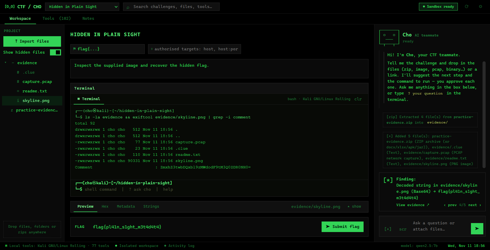

# Cho — CTF Workspace

[](https://github.com/kevinmathew47/Cho/actions/workflows/ci.yml)
[](https://kevinmathew47.github.io/Cho/)
[](LICENSE)

**An open-source, AI-assisted workspace for Capture-the-Flag competitions and isolated practice labs.**

Cho is a terminal-style desktop app that brings your CTF toolkit, a real shell, and a local AI teammate into one window. It helps you organise a challenge, inspect the files, run the right tool, and reason about the output — on your own machine, offline.

> ⚠️ **Use it only for CTFs you are entered in and practice environments you are allowed to use.** It is an assistant, not an autopilot: it does not guarantee a solve, and it will not exploit a real target on its own. Follow each competition's rules on AI and automation.



---

## Features

- **One terminal.** A real Kali/WSL (or container, or PowerShell) shell in the challenge folder. Type commands, or type `? your question` to ask the AI — same prompt.
- **Cho, a local AI teammate.** Runs on [Ollama](https://ollama.com) on your own GPU/CPU — nothing leaves your machine. It suggests the next step and the command; you approve each one. It labels what it can prove (`VERIFIED:`) separately from what it guesses (`ASSUMPTION:`).
- **Built-in analysis** that works even before you install anything: file-type detection, hidden/embedded files, entropy, metadata (PNG/JPEG/GIF/PDF) with anomaly detection, flag scanning, and auto-decoding (base64/32/58, hex, binary, URL, morse, ROT/Caesar/Atbash, XOR) — including encodings buried inside HTML/text.
- **A 100+ tool catalogue** across all six CTF categories — crypto, forensics, steganography, reversing, pwn, web — each with an example command and a one-line install. Mirrors the [awesome-ctf](https://github.com/apsdehal/awesome-ctf) solving stack.
- **Remote targets, safely.** Authorise a Hack The Box box IP or a challenge URL per challenge; `fetch <url>` pulls an authorised page in and scans it. Any host not on the list is refused.
- **Controlled execution.** Destructive commands are always blocked; anything touching the network waits for your click; an optional container mode isolates each command with no network by default.
- **Projects.** Each challenge is a plain folder with its files, notes, candidate flags and command history — easy to back up or put in git.

## Requirements

- Windows 10/11 with **WSL2** (Kali recommended), or any OS with **Docker/Podman** for container mode.
- [Node.js](https://nodejs.org) 18+.
- [Ollama](https://ollama.com) + a small model (e.g. `qwen2.5:7b`) for the AI assistant — optional; the analysis, viewers and terminal work without it.

## Install

```bash
git clone https://github.com/kevinmathew47/Cho.git
cd Cho
npm install
npm start
```

Then, from the app's **Settings** (gear, top-right):

1. **Kali (WSL)** — one-click `wsl --install -d kali-linux`, then run the bundled `scripts/setup-wsl.sh` to install the tool stack.
2. **Ollama** — one-click install, then download a model such as `qwen2.5:7b`.
3. **Container mode** (optional) — build the analysis image: `docker build -t cho-ctf-tools:latest docker/`.

None of these are required to try it: open the app, drop in a challenge file, and the built-in analysis and terminal work immediately.

## Try it

Drop [`samples/practice-evidence.zip`](samples/practice-evidence.zip) onto the window, set the flag format to `flag{...}`, and ask Cho to solve it, or inspect it yourself in the terminal.

## How it works

Electron shell · sandboxed renderer · a Node main process that runs the analysis, classifies every command (allow / approve / block), enforces the authorised-target scope, and relays to the local model. Full write-up in [docs/ARCHITECTURE.md](docs/ARCHITECTURE.md).

## Safety & scope

- The app keeps work inside the challenge folder and the hosts you authorise. The limits of these checks (e.g. the scope gate reads command text; container mode is the real network isolation) are documented in [docs/ARCHITECTURE.md](docs/ARCHITECTURE.md) and [SECURITY.md](SECURITY.md).
- It does **not** claim to support every tool or to win competitions. It prioritises reliable, transparent help.

## Contributing

See [CONTRIBUTING.md](CONTRIBUTING.md). Tests: `npm test`.

## Licence

[MIT](LICENSE). Bundled tool licences are listed in [THIRD_PARTY_LICENSES.md](THIRD_PARTY_LICENSES.md); tools you install through the app keep their own licences.
